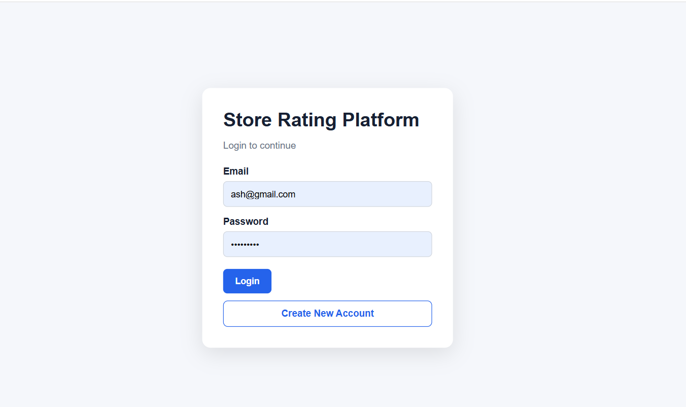
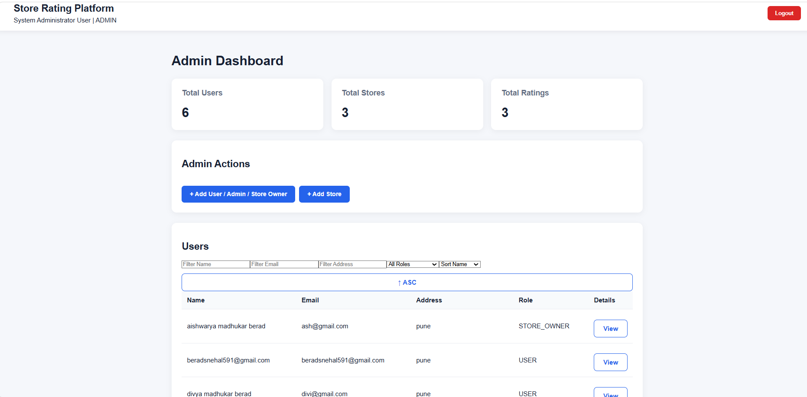
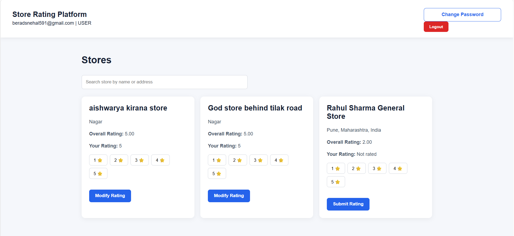
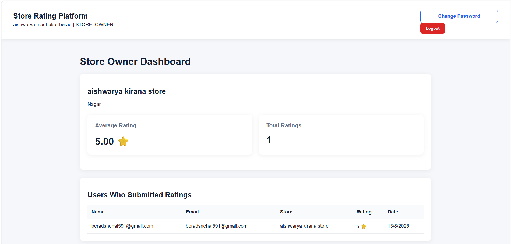

# 🏪 Store Rating Platform

<p align="center">
  <h2 align="center">Store Rating Platform</h2>
  <p align="center">
    Full-Stack Store Rating & Review Application
  </p>
</p>

---

## 📸 Project Screenshots

### 🔐 Login



### 👨‍💼 Admin Dashboard



### 👤 Normal User Dashboard



### 🏪 Store Owner Dashboard



---

## 📌 About the Project

Store Rating Platform is a full-stack web application developed for the
Roxiler FullStack Intern Coding Challenge.

The application allows users to view registered stores and submit ratings
from 1 to 5.

The system supports three different roles:

- System Administrator
- Normal User
- Store Owner

Each role has different permissions and dashboard functionality.

---

## 🛠️ Tech Stack

### Frontend
- React.js
- Axios
- CSS

### Backend
- Node.js
- Express.js
- JWT Authentication
- bcrypt.js

### Database
- MySQL

---

## 👨‍💼 System Administrator

- Login
- Dashboard
- View total users
- View total stores
- View total ratings
- Add normal users
- Add administrators
- Add store owners
- Add stores
- Assign stores to store owners
- View users
- View stores
- Filter users and stores
- Sort listings
- View user details
- Logout

---

## 👤 Normal User

- Sign up
- Login
- View all stores
- Search stores by name
- Search stores by address
- View overall rating
- Submit rating from 1 to 5
- Modify submitted rating
- Logout

---

## 🏪 Store Owner

- Login
- View average store rating
- View total ratings
- View users who submitted ratings
- Logout

---

## ✅ Form Validation

- Name: 20–60 characters
- Address: Maximum 400 characters
- Password: 8–16 characters
- Password must contain at least one uppercase letter
- Password must contain at least one special character
- Email validation
- Rating: 1–5

---

## 🔐 Authentication & Security

- JWT-based authentication
- Role-based authorization
- bcrypt password hashing
- Protected API routes
- Input validation

---

## 📂 Project Structure

```text
store-rating-platform/
│
├── backend/
│   ├── src/
│   │   ├── controllers/
│   │   ├── middleware/
│   │   ├── routes/
│   │   ├── services/
│   │   └── server.js
│   └── package.json
│
├── frontend/
│   ├── src/
│   ├── public/
│   └── package.json
│
├── screenshots/
│   ├── login.png
│   ├── admin-dashboard.png
│   ├── user-dashboard.png
│   └── owner-dashboard.png
│
└── README.md
